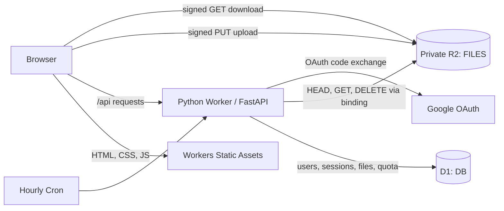
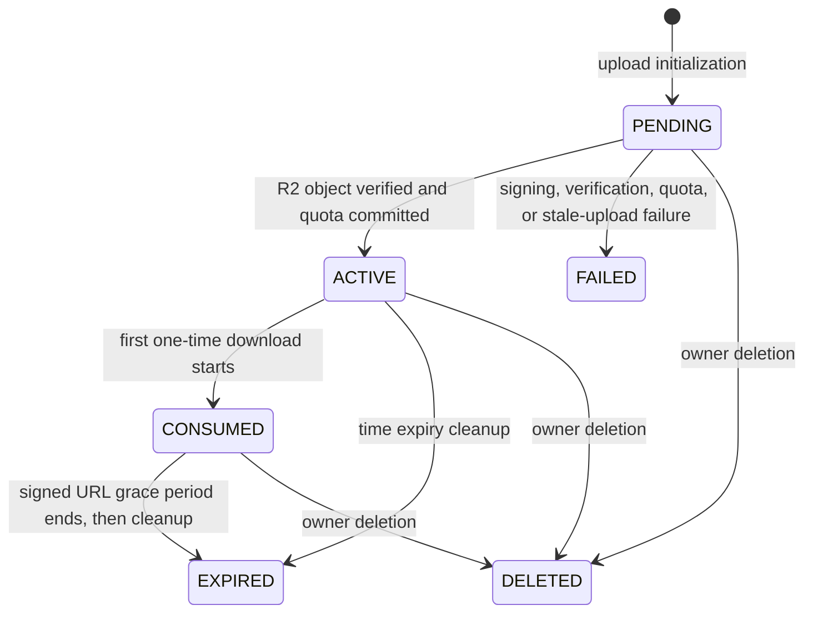
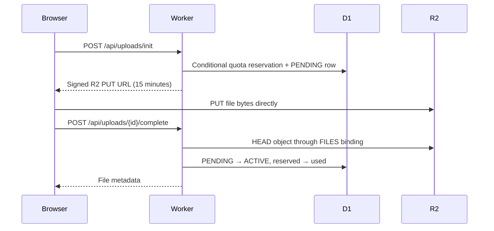

# QuickDrop Technical Documentation

This document describes the QuickDrop implementation as it exists in this repository. It is intended for developers, reviewers, operators, and anyone maintaining the Cloudflare deployment.

## 1. System overview

QuickDrop is a temporary private file-sharing application. Authenticated users upload files, choose an expiration policy, and create public share links. Recipients do not need an account. File bytes live in a private Cloudflare R2 bucket; metadata, identity records, sessions, quota counters, and lifecycle state live in Cloudflare D1.

### Technology stack

| Layer | Implementation |
| --- | --- |
| Web UI | React 19, TypeScript, Vite 6 |
| API | FastAPI on Cloudflare Python Workers |
| Worker adapter | `workers.asgi` |
| Metadata | Cloudflare D1 |
| File storage | Private Cloudflare R2 bucket |
| Authentication | Google OAuth 2.0 / OpenID Connect |
| Cleanup | Cloudflare Cron Trigger, hourly |
| Python tooling | Python 3.13, `uv`, `workers-py`, `workers-runtime-sdk` |
| Deployment | Wrangler |

### Runtime architecture



The production Worker does not proxy file uploads. It validates the request, reserves quota, creates a `PENDING` D1 row, and returns a short-lived signed R2 PUT URL. The browser then uploads directly to R2.

## 2. Repository layout

```text
QuickDrop/
├── frontend/
│   ├── src/
│   │   ├── components/Brand.tsx
│   │   ├── pages/Dashboard.tsx
│   │   ├── pages/Download.tsx
│   │   ├── pages/Login.tsx
│   │   ├── api.ts
│   │   ├── App.tsx
│   │   ├── main.tsx
│   │   └── styles.css
│   ├── index.html
│   ├── package.json
│   └── vite.config.ts
├── migrations/
│   ├── 0001_schema.sql
│   └── 0002_one_time_download.sql
├── src/
│   ├── app.py
│   ├── cleanup.py
│   ├── constants.py
│   ├── db.py
│   ├── r2util.py
│   ├── util.py
│   └── worker.py
├── tests/
│   ├── fakes.py
│   └── test_*.py
├── .dev.vars.example
├── r2-cors.example.json
├── pyproject.toml
├── start.sh
├── wrangler.jsonc
└── README.md
```

Generated or local-only directories such as `frontend/dist`, `frontend/node_modules`, `python_modules`, `.wrangler`, virtual environments, `.dev.vars`, and `.env.production.local` are ignored by Git.

## 3. Worker entrypoint and request routing

The Worker entrypoint is `src/worker.py`:

```python
from app import app
from workers import asgi

Default = asgi.entrypoint(app)
```

The same exported entrypoint receives scheduled events. `Default.scheduled` calls `cleanup.run_cleanup(env)` and awaits its completion.

Cloudflare bindings are exposed to FastAPI through `request.scope["env"]`. `wrangler.jsonc` defines the following bindings:

| Binding | Type | Purpose |
| --- | --- | --- |
| `DB` | D1 database | Users, identities, sessions, file metadata, state, and quota counters |
| `FILES` | R2 bucket | Actual file objects |
| `ASSETS` | Workers Static Assets | Compiled React application |

Static asset routing uses SPA fallback behavior. The Worker runs first for `/api/*` and `/d/*`; other frontend routes fall back to `frontend/dist/index.html`.

## 4. Configuration

### Wrangler configuration

Important production settings in `wrangler.jsonc`:

- Worker environment: `production`
- Python compatibility flag: `python_workers`
- Compatibility date: `2026-09-07`
- D1 binding: `DB`
- R2 binding: `FILES`
- Static asset binding: `ASSETS`
- Cron schedule: `0 * * * *`
- Worker logs: enabled with 100% head sampling
- Worker traces: enabled with 1% head sampling

Wrangler environment fields are not inherited automatically. The production environment therefore repeats its variables and bindings explicitly.

### Environment variables and secrets

| Name | Classification | Required in production | Purpose |
| --- | --- | --- | --- |
| `ENVIRONMENT` | Variable | Yes | Enables production or development behavior |
| `APP_ORIGIN` | Variable | Yes | Canonical origin used for OAuth callbacks and share links |
| `GOOGLE_CLIENT_ID` | Secret binding in current deployment | Yes | Google OAuth client identifier |
| `GOOGLE_CLIENT_SECRET` | Secret | Yes | Google OAuth client secret |
| `R2_ACCOUNT_ID` | Variable | Yes | Account portion of the R2 S3 endpoint |
| `R2_ACCESS_KEY_ID` | Secret | Yes | R2 S3 signing credential |
| `R2_SECRET_ACCESS_KEY` | Secret | Yes | R2 S3 signing credential |
| `R2_BUCKET_NAME` | Variable | Yes | Bucket used when producing signed URLs |

Local values belong in `.dev.vars`. Production values can be staged in the Git-ignored `.env.production.local` file and uploaded with Wrangler. Never commit or paste secret values into logs, tickets, or documentation.

### R2 CORS

The private bucket needs CORS only for browser-to-R2 PUT uploads. Start with `r2-cors.example.json` and replace its placeholder origin with the exact production origin.

The intended policy is:

- Exact application origin; no wildcard
- Method: `PUT`
- Allowed header: `Content-Type`
- Exposed header: `ETag`
- Maximum age: 3600 seconds

Signed downloads are top-level browser navigations and do not require permissive bucket CORS. The bucket must remain private.

## 5. Database model

Migrations live in `migrations/` and are applied in filename order.

### `users`

| Column | Description |
| --- | --- |
| `id` | Random internal user identifier; primary key |
| `email` | Latest provider email, nullable |
| `display_name` | Latest provider display name, nullable |
| `storage_used_bytes` | Bytes attributed to completed or consumed files pending cleanup |
| `storage_reserved_bytes` | Bytes reserved by `PENDING` uploads |
| `created_at`, `updated_at` | Unix timestamps in seconds |

User records are provider-neutral. There is no Google-specific identifier in this table.

### `auth_identities`

| Column | Description |
| --- | --- |
| `id` | Random identity record ID; primary key |
| `user_id` | Foreign key to `users.id` |
| `provider` | Identity provider name, currently `google` or local-development `dev` |
| `provider_subject` | Provider's stable subject identifier |
| `provider_email` | Provider-reported email, nullable |
| `created_at` | Unix timestamp |

`UNIQUE(provider, provider_subject)` prevents the same external identity from being attached more than once.

### `sessions`

| Column | Description |
| --- | --- |
| `id` | Random internal session row ID |
| `user_id` | Foreign key to `users.id` |
| `token_hash` | SHA-256 hash of the browser session token; unique |
| `expires_at` | Session expiration timestamp |
| `created_at` | Creation timestamp |

The plaintext session token exists only in the browser cookie. D1 stores only its hash.

### `files`

| Column | Description |
| --- | --- |
| `id` | Random file metadata ID |
| `user_id` | Owner; foreign key to `users.id` |
| `original_filename` | Sanitized display/download filename |
| `content_type` | Client-declared media type, nullable |
| `size_bytes` | Reserved size while pending; actual R2 size after completion |
| `r2_key` | Server-generated private object key; unique |
| `status` | Lifecycle state |
| `expires_at` | File expiration timestamp |
| `share_token_hash` | SHA-256 hash of the current public share token, nullable |
| `created_at`, `updated_at` | Unix timestamps |
| `completed_at` | Upload completion timestamp, nullable |
| `delete_after_download` | Boolean integer added by migration `0002` |

### Indexes and constraints

- Primary keys on all four tables
- Foreign keys from identities, sessions, and files to users
- Unique `(provider, provider_subject)` identity constraint
- Unique session token hash
- Unique R2 object key
- Unique share-token hash
- Indexes for identity ownership, session ownership/expiration, file ownership, file expiration, and stale-file lookup

## 6. File lifecycle



Only `ACTIVE` files can be shared or downloaded. The dashboard lists `ACTIVE` and `PENDING` files. Terminal records remain in D1 for lifecycle history, while their share-token hashes are cleared.

### Status meanings

| Status | Meaning |
| --- | --- |
| `PENDING` | Quota is reserved; upload has not been verified |
| `ACTIVE` | R2 object exists and is available to its owner/share link |
| `CONSUMED` | A one-time download was claimed; the public link is invalid |
| `EXPIRED` | Time or one-time grace period elapsed and cleanup processed the file |
| `DELETED` | Owner deleted the file |
| `FAILED` | Upload initialization/completion failed or became stale |

## 7. Authentication and sessions

### Google sign-in flow

1. Browser requests `GET /api/auth/google`.
2. The Worker generates a cryptographically random OAuth state value.
3. The state is stored in an HttpOnly cookie for 10 minutes.
4. The browser is redirected to Google with scopes `openid email profile`.
5. Google redirects to `/api/auth/google/callback` with a code and state.
6. The Worker requires the callback state to match the state cookie.
7. The Worker exchanges the authorization code at Google's token endpoint.
8. It reads the ID-token claims and checks audience, issuer, subject, and expiration.
9. It upserts a provider-neutral identity using `(provider, provider_subject)`.
10. It creates a random session token, stores only its SHA-256 hash, and sets the session cookie.

Session lifetime is 14 days. The session cookie is:

- HttpOnly
- `SameSite=Lax`
- `Secure` for HTTPS production requests
- Scoped to `/`

Logout removes the hashed session row and expires the cookie.

### Local development login

If Google credentials are absent and `ENVIRONMENT=development`, `/api/auth/google` redirects to `/api/dev/login`. This creates or reuses the identity:

```text
provider=dev
provider_subject=local-dev-user
```

The development login endpoint returns 404 outside development.

## 8. Authorization model

All owner-only file queries include both the file ID and authenticated `user_id`. This prevents a user from listing, deleting, sharing, or completing another user's files.

| Operation | Ownership enforcement |
| --- | --- |
| List files | `WHERE user_id = current_user` |
| Delete file | `WHERE id = ? AND user_id = ?` |
| Share file | `WHERE id = ? AND user_id = ?` |
| Complete upload | `WHERE id = ? AND user_id = ?` |
| Development PUT | `WHERE id = ? AND user_id = ?` |

Public recipients are authorized by a high-entropy share token. They do not receive owner permissions and do not need a session.

## 9. Quota enforcement

Constants:

- Per-user quota: `524288000` bytes (500 MiB)
- Per-file maximum: `524288000` bytes (500 MiB)
- Local proxied-upload maximum: 10 MiB
- Pending-upload lifetime: 1 hour

### Reservation at initialization

Upload initialization performs a conditional user update:

```text
storage_used_bytes + storage_reserved_bytes + requested_size <= 524288000
```

Only when that update changes one row is the `PENDING` file inserted. Because quota is incremented through the conditional D1 update, simultaneous initializations cannot both reserve the same remaining space.

### Reconciliation at completion

The completion endpoint does not trust the frontend's declared size. It issues an R2 `HEAD` through the `FILES` binding and reads the actual object size.

Completion succeeds only when:

- The caller owns the file
- The file is still `PENDING`
- The R2 object exists
- Actual size does not exceed 500 MiB
- The file has not expired
- Replacing the declared reservation with the actual size still fits quota

On success, reserved bytes decrease by the declared size and used bytes increase by the actual size.

### Reservation release

Reserved quota is released when:

- Signed-URL generation fails
- The uploaded object cannot be found
- The actual object exceeds the file limit
- Actual size would exceed current quota
- The owner deletes a pending file
- Cron marks a pending upload stale after one hour

Used quota is reclaimed when an active/consumed file expires or is deleted.

## 10. Upload flow



### Object keys

Object keys are generated only by the server:

```text
uploads/{user_id}/{file_id}/{random_token}
```

The original filename is never used as an R2 path. It is sanitized and retained only as metadata and for the download `Content-Disposition` value.

### Signed PUT properties

- AWS Signature Version 4
- R2 S3 endpoint for the configured account
- 15-minute expiration
- `UNSIGNED-PAYLOAD`
- `Content-Type` is signed when supplied and must match the upload request
- Credentials are available only to the Worker

### Development upload path

Without R2 signing credentials in development, initialization returns `/api/dev/uploads/{id}`. The Worker accepts the PUT through its R2 binding. This fallback is development-only and limited to 10 MiB.

## 11. Sharing and downloads

Creating a share link generates a 32-byte cryptographically random URL-safe token. The plaintext token is returned once in the URL; only its SHA-256 hash is stored in D1. Creating another share link rotates the token and invalidates the previous share URL.

### Standard download

1. Recipient opens `/d/{share_token}`.
2. React requests `GET /api/d/{share_token}` for metadata.
3. The API verifies token hash, `ACTIVE` status, and time expiry.
4. The recipient clicks Download.
5. `GET /api/d/{share_token}/download` creates a signed R2 GET URL.
6. The Worker returns a no-store 302 redirect to R2.

The normal signed GET lifetime is at most five minutes and is shortened when the file's remaining lifetime is less than five minutes.

### Expire after first download

When `delete_after_download=true`, the metadata page does not consume the link. The link is claimed when the recipient starts the download.

The claim is a conditional D1 update that:

- Requires the file to still be `ACTIVE`
- Requires the same share-token hash
- Changes status to `CONSUMED`
- Clears the share-token hash immediately
- Sets cleanup eligibility to the end of a maximum 60-second signed-URL grace period

Concurrent download requests can read the row, but only one can successfully perform this conditional update. Later requests cannot obtain a new signed URL. Cron deletes the object and reclaims quota after the grace period has elapsed.

Important semantic detail: this is “expire when the first download starts,” not proof that the recipient finished receiving every byte. The issued R2 URL may be retried during its maximum 60-second validity window.

## 12. Cleanup and expiration

The scheduled handler runs hourly (`0 * * * *`) and performs four tasks:

1. Find due `ACTIVE` and `CONSUMED` files.
2. Attempt to delete each R2 object, mark the row `EXPIRED`, clear its share hash, and decrement used quota.
3. Find `PENDING` uploads older than one hour, delete any partial object, mark them `FAILED`, and release reserved quota.
4. Retry R2 deletion for `EXPIRED`, `DELETED`, and `FAILED` rows and delete expired sessions.

Conditional status checks and `changes()` gating make repeated executions safe. R2 deletion errors are suppressed for the current run; terminal rows remain eligible for deletion on later Cron runs.

Because Cron runs hourly, physical object removal and quota reclamation can occur up to roughly one Cron interval after a file becomes eligible.

## 13. API reference

FastAPI errors use the standard JSON shape:

```json
{ "detail": "Error message" }
```

### Endpoint summary

| Method | Path | Authentication | Purpose |
| --- | --- | --- | --- |
| `GET` | `/api/health` | Public | Service/environment health response |
| `GET` | `/api/auth/google` | Public | Start Google authentication |
| `GET` | `/api/auth/google/callback` | OAuth state cookie | Complete Google authentication |
| `GET` | `/api/dev/login` | Development only | Create local development session |
| `POST` | `/api/auth/logout` | Optional session | Delete session and cookie |
| `GET` | `/api/me` | Required | Current user and quota counters |
| `GET` | `/api/files` | Required | List owner's active/pending files |
| `DELETE` | `/api/files/{file_id}` | Required, owner | Delete file and reclaim quota |
| `POST` | `/api/uploads/init` | Required | Reserve quota and create signed upload |
| `PUT` | `/api/dev/uploads/{file_id}` | Required, owner, development | Local upload fallback |
| `POST` | `/api/uploads/{file_id}/complete` | Required, owner | Verify R2 object and activate file |
| `POST` | `/api/files/{file_id}/share` | Required, owner | Create or rotate public share link |
| `GET` | `/api/d/{share_token}` | Public token | Public file metadata |
| `GET` | `/api/d/{share_token}/download` | Public token | Redirect to signed R2 GET or local fallback |
| `GET` | `/api/d/{share_token}/content` | Public token | Compatibility alias for download |
| `GET` | `/d/{share_token}` | Public | Serve public React download page |

### Initialize upload

Request:

```http
POST /api/uploads/init
Content-Type: application/json
Cookie: qd_session=...
```

```json
{
  "filename": "report.pdf",
  "content_type": "application/pdf",
  "size_bytes": 1048576,
  "expiry": "24h",
  "delete_after_download": true
}
```

Accepted expiry values are `1h`, `6h`, `24h`, `3d`, and `7d`. The default is `24h`.

Production response:

```json
{
  "id": "server-generated-file-id",
  "upload_url": "https://...r2.cloudflarestorage.com/...",
  "upload_mode": "signed",
  "headers": {
    "Content-Type": "application/pdf"
  },
  "expires_in": 900,
  "r2_key": null
}
```

The R2 object key is deliberately not returned.

### Complete upload

```http
POST /api/uploads/{file_id}/complete
Cookie: qd_session=...
```

The response is normalized file metadata containing `id`, filename, content type, actual size, status, expiry, timestamps, share state, and the one-time-download flag.

### Share file

```http
POST /api/files/{file_id}/share
Content-Type: application/json
Cookie: qd_session=...
```

The optional body can contain a new expiry choice. The current frontend sends `{}` and preserves the upload expiry.

Response:

```json
{
  "share_url": "https://application-origin/d/random-token",
  "expires_at": 1790000000
}
```

### Public download metadata

```http
GET /api/d/{share_token}
```

Response:

```json
{
  "filename": "report.pdf",
  "content_type": "application/pdf",
  "size_bytes": 1048576,
  "expires_at": 1790000000,
  "download_url": "/api/d/{share_token}/download",
  "download_mode": "one-time",
  "expires_in": 60,
  "delete_after_download": true
}
```

## 14. Frontend architecture

The frontend is a small client-rendered React application with no external state-management library.

### Routes

| Route | Component | Behavior |
| --- | --- | --- |
| `/login` | `Login` | Google sign-in and product overview |
| `/` | `Dashboard` | Auth check, upload controls, quota, files, sharing, deletion |
| `/d/:token` | `Download` | Public file metadata and download action |
| Other | Redirect | Redirect to `/` |

### API client

`frontend/src/api.ts` centralizes fetch calls, error parsing, data types, byte/time formatting, and XHR upload progress. Authenticated fetches use `credentials: "include"`.

XMLHttpRequest is used only for the direct R2 PUT because it provides browser upload progress events. The request applies the exact signed headers returned by the API.

### Dashboard behavior

- Drag-and-drop or file picker
- Expiry selector
- “Expire after first download” checkbox
- Upload progress
- Used, available, and reserved storage display
- Active/pending file list
- Copy share link
- Delete file
- Responsive desktop/mobile layout
- Loading, success, and error states

The built output is written to `frontend/dist` and served by Workers Static Assets.

## 15. Security design

### Implemented controls

- Provider-neutral identity model
- Cryptographically random user IDs, file IDs, session tokens, share tokens, OAuth state, and object-key suffixes
- Only token hashes stored for sessions and public links
- Owner ID included in every owner-only file query
- Parameterized D1 statements; user input is not concatenated into SQL
- Server-generated R2 keys; filenames never become object paths
- Filename sanitization for display and `Content-Disposition`
- Private R2 bucket
- Short-lived signed PUT and GET URLs
- Exact-origin, PUT-only R2 CORS policy
- Actual R2 object size checked at completion
- Atomic conditional quota reservation
- OAuth state validation
- HttpOnly, SameSite cookies; Secure in production
- Public downloads reject missing, expired, consumed, deleted, or failed files
- Secret files and generated signing credentials are Git-ignored

### Trust boundaries

The browser is untrusted for identity, ownership, file size, object keys, state, quota, and expiration. The Worker is the policy-enforcement layer. D1 is the authoritative metadata and quota store; R2 is authoritative for actual object presence and size.

## 16. Local development

### Prerequisites

- Python 3.13
- `uv`
- Node.js and npm
- Wrangler/Cloudflare tooling installed through the existing commands

### Install dependencies

```bash
uv sync
npm --prefix frontend install
```

For reproducible frontend installs in CI, use:

```bash
npm --prefix frontend ci
```

### Create local variables

PowerShell:

```powershell
Copy-Item .dev.vars.example .dev.vars
```

Bash:

```bash
cp .dev.vars.example .dev.vars
```

Google and R2 signing credentials can remain blank for basic local development. Blank Google credentials enable the development identity. Blank R2 signing credentials enable the local 10 MiB Worker upload path.

### Apply local migrations

```bash
uv run pywrangler d1 migrations apply DB --local --env development
```

Equivalent Wrangler command used by the current environment:

```bash
npx wrangler d1 migrations apply DB --local --env development
```

### Build and run

```bash
npm --prefix frontend run build
uv run pywrangler dev --env development
```

The combined application is served at `http://localhost:8787`.

On Unix-like systems, `./start.sh` installs missing frontend dependencies, builds the frontend, creates `.dev.vars` if needed, applies local migrations, and starts the Worker.

### Optional frontend development server

Run the Worker and Vite in separate terminals:

```bash
uv run pywrangler dev --env development
npm --prefix frontend run dev
```

Vite listens on port 5173 and proxies `/api` to `http://127.0.0.1:8787`.

### Local Google OAuth

Set these values in `.dev.vars`:

```dotenv
GOOGLE_CLIENT_ID=...
GOOGLE_CLIENT_SECRET=...
APP_ORIGIN=http://localhost:8787
```

Configure this authorized redirect URI in Google Cloud:

```text
http://localhost:8787/api/auth/google/callback
```

### Test scheduled cleanup locally

With the local Worker running:

```bash
curl "http://localhost:8787/cdn-cgi/local/scheduled?format=json"
```

## 17. Tests and validation

Run backend tests:

```bash
uv run pytest
```

Run the frontend type check and production build:

```bash
npm --prefix frontend run build
```

Run a Worker packaging dry run:

```bash
npx wrangler deploy --env production --dry-run
```

### Current automated coverage

- Token hashing and token uniqueness
- Default expiry
- Filename/path sanitization
- Quota boundary, reserved quota, and combined quota math
- R2 signing parameters and secret non-disclosure
- Missing signing credentials
- Identity-provider fetch argument handling
- Expired-file cleanup and quota reclamation
- Stale pending cleanup and reservation release
- Consumed one-time file cleanup
- Atomic one-time download claim

The current suite contains 16 tests. It uses in-memory D1/R2 fakes and does not replace real Cloudflare staging tests.

## 18. Production deployment

### One-time resource setup

Authenticate and verify the target account:

```bash
npx wrangler login
npx wrangler whoami
```

Create resources if they do not already exist:

```bash
npx wrangler d1 create quickdrop
npx wrangler r2 bucket create quickdrop-files
```

Put the returned D1 database ID into both the top-level and production D1 bindings in `wrangler.jsonc`.

Create an R2 Account API token with **Object Read & Write** permission restricted to `quickdrop-files`. Save its Access Key ID and Secret Access Key in `.env.production.local`; do not use the general API token value as an S3 credential.

### Configure secrets

Required production secret names:

```dotenv
GOOGLE_CLIENT_ID=...
GOOGLE_CLIENT_SECRET=...
R2_ACCESS_KEY_ID=...
R2_SECRET_ACCESS_KEY=...
```

Upload secrets without placing values in command arguments:

```bash
npx wrangler secret bulk .env.production.local --env production
```

Verify names only:

```bash
npx wrangler secret list --env production
```

### Apply CORS

```bash
npx wrangler r2 bucket cors set quickdrop-files --file r2-cors.json
npx wrangler r2 bucket cors list quickdrop-files
```

### Release sequence

Apply migrations before deploying code that depends on them:

```bash
npx wrangler d1 migrations apply DB --remote --env production
npm --prefix frontend run build
npx wrangler deploy --env production --dry-run
npx wrangler deploy --env production
```

`pywrangler deploy --env production` is also supported by the repository tooling. The current Windows deployment uses a prebuilt `python_modules` directory and `npx wrangler deploy`.

If Python packages need to be rebuilt for the Worker on Windows, the validated vendoring command for the locked versions is:

```powershell
uv pip install --target python_modules `
  --python-version 3.13 `
  --python-platform wasm32-pyodide2025 `
  --extra-index-url https://index.pyodide.org/0.28.3 `
  --index-strategy unsafe-best-match `
  --only-binary :all: `
  "fastapi==0.127.1" `
  "workers-runtime-sdk==1.9.1"
```

### Post-deployment verification

```bash
curl https://your-worker.example/api/health
npx wrangler secret list --env production
npx wrangler d1 migrations list DB --remote --env production
```

Then test in a real browser:

1. Google sign-in
2. Small standard upload
3. Direct R2 upload progress
4. Upload completion and actual-size reconciliation
5. Share link in an unauthenticated/incognito browser
6. Standard download
7. One-time download followed by a rejected second attempt
8. Delete and quota refresh
9. Expiry/Cron behavior

## 19. Operations

### Health check

`GET /api/health` returns:

```json
{
  "ok": true,
  "service": "quickdrop",
  "environment": "production"
}
```

This confirms the Worker can execute, but it does not probe Google, D1, or R2.

### Live logs

```bash
npx wrangler tail --env production
```

Do not log cookie values, OAuth codes, Google tokens, signed R2 URLs, session tokens, share tokens, or secret values.

### Useful read-only checks

```bash
npx wrangler whoami
npx wrangler secret list --env production
npx wrangler d1 migrations list DB --remote --env production
npx wrangler r2 bucket cors list quickdrop-files
```

### Secret rotation

1. Create a replacement provider/R2 credential.
2. Upload the new Worker secret.
3. Verify sign-in or a small upload/download.
4. Revoke the old credential.

Remember that Wrangler secret updates create and deploy a new Worker version.

## 20. Troubleshooting

| Symptom | Likely cause | Check/fix |
| --- | --- | --- |
| `Google OAuth is not configured` | Missing Google secret bindings | Verify `GOOGLE_CLIENT_ID` and `GOOGLE_CLIENT_SECRET` names with `wrangler secret list` |
| `Invalid OAuth state` | Lost/expired state cookie, origin mismatch, or repeated callback | Restart login; verify `APP_ORIGIN` and Google callback URI |
| `Signed uploads are not configured` | Missing R2 S3 signing values | Verify `R2_ACCOUNT_ID`, `R2_ACCESS_KEY_ID`, and `R2_SECRET_ACCESS_KEY` |
| R2 PUT fails in browser | CORS origin/header mismatch or expired signed URL | Verify exact origin, `Content-Type`, system clock, and bucket CORS |
| `Uploaded object was not found` | PUT failed or completion ran before R2 object existed | Inspect browser network requests and R2 bucket/object key flow |
| `Storage quota exceeded` | Used + reserved + requested/actual bytes exceed 500 MiB | Delete files, wait for pending cleanup, and inspect `/api/me` counters |
| `Upload is not pending` | Duplicate/late completion or terminal state | Refresh the dashboard and inspect the file state |
| Second one-time download fails | Expected behavior | One-time link was consumed by the first download request |
| Old UI after deployment | Cached assets or frontend was not rebuilt | Run the frontend build, deploy, then hard-refresh |
| `no such column: delete_after_download` | Migration `0002` not applied | Apply D1 migrations before deploying current code |
| Large download fails without signing secrets | Worker fallback buffers the file | Restore R2 signing credentials; production downloads should redirect to R2 |

## 21. Known limitations and future hardening

These are implementation facts, not claims that the feature exists:

1. **OIDC validation is incomplete.** The callback validates state plus ID-token audience, issuer, subject, and expiration, but it does not currently verify the ID-token signature against Google's JWKS or validate an OIDC nonce. Add standards-complete JWT verification before using the app for higher-assurance identities.
2. **One-time means first download initiation.** The share token is single-use, but the resulting signed R2 URL can be retried for up to 60 seconds.
3. **Cleanup is scheduled, not immediate.** Eligible objects and quota can remain until the next hourly Cron execution.
4. **No malware scanning or content moderation.** Files are stored and delivered as uploaded.
5. **No resumable/multipart upload.** A failed large single PUT must be restarted.
6. **Production requires signing credentials.** The non-signing download fallback buffers the file in the Worker and is suitable only for small local-development objects.
7. **No application-layer file encryption.** QuickDrop controls access with a private bucket and signed URLs; it does not encrypt each file with a user-held key.
8. **No application rate limiting or bot challenge.** Cloudflare platform protections may still apply, but the application does not implement per-user/API throttling or Turnstile.
9. **External font dependency.** The frontend loads IBM Plex fonts from Google Fonts; the UI falls back to system fonts if unavailable.
10. **Tests are not Cloudflare-runtime integration tests.** Real staging is still required for OAuth redirects, cookie behavior, R2 CORS, signed URLs, D1 bindings, Cron, and large-file behavior.

## 22. Maintenance checklist

Before each release:

- Review schema changes and add a new numbered migration; never edit an already-applied migration.
- Run `uv run pytest`.
- Run `npm --prefix frontend run build`.
- Run `npx wrangler deploy --env production --dry-run`.
- Confirm the authenticated Cloudflare account and production environment.
- Apply migrations before deploying dependent code.
- Verify required secret names without printing their values.
- Confirm `DB`, `FILES`, and `ASSETS` bindings in Wrangler output.
- Exercise sign-in, upload, share, download, one-time download, deletion, and quota display in staging or a controlled production smoke test.
- Check Workers logs after deployment.

